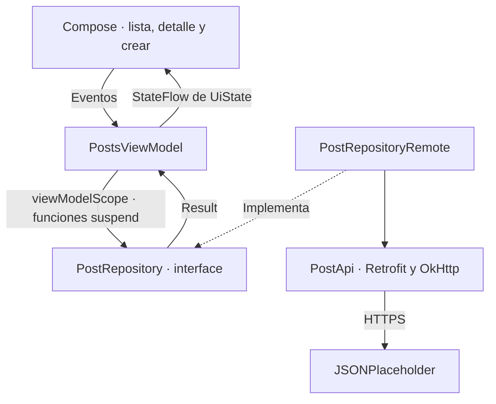

# MuroCampus — Laboratorio 09 · Servicio Web

Programación en Móviles · Tecsup · Cuarto ciclo

Fuente: [GLAB-S09-JLEONS-2026-2.pdf](./GLAB-S09-JLEONS-2026-2.pdf), 17 páginas. La Fase 1 se desarrolla personalmente en `main`. El docente prohíbe usar IA en esa fase. Usa el PDF, tus apuntes y la documentación oficial para escribir el código, ejecutar las pruebas y responder las preguntas con tus propias palabras. Si el docente también restringe el uso de guías preparadas con IA, consulta esta guía únicamente si te lo autoriza.

## Punto de partida

El proyecto base original del docente no fue proporcionado. La configuración Gradle, el manifiesto, los recursos y todos los archivos Kotlin del proyecto base en esta carpeta fueron reconstruidos con IA a partir del PDF. Los scripts y el JAR del Wrapper proceden de Gradle. La base usa Kotlin 2.1.0, Gradle 8.9, AGP 8.7.2 y `compileSdk` 35.

Los ejercicios [A] quedan a cargo del estudiante. En el paso 0, abre esta carpeta directamente en Android Studio. En el paso 1, completa los TODO del manifiesto y de `app/build.gradle.kts`. El plugin de serialización y las dependencias compartidas de red ya están activos para compilar el ejemplo [E] de `Usuario`. La prueba temporal del paso 4 y las pruebas funcionales del laboratorio se realizan después de completar sus pasos.

| Nivel del PDF | Archivos |
| --- | --- |
| [E] Entregado | `MainActivity.kt`, `viewmodel/PostsViewModelFactory.kt`, `viewmodel/UiState.kt` (p. 6), `ui/Componentes.kt` y `ui/theme/`. También se entrega el ejemplo de `Usuario` con su modelo, API, Repository y estado. |
| [G] Guiado | `AndroidManifest.xml` y `app/build.gradle.kts` (paso 1), `model/Modelos.kt` (con `Usuario` [E]) y `data/remote/RetrofitClient.kt`. |
| [A] Por crear | `data/remote/PostApi.kt`, `data/PostRepository.kt`, `viewmodel/PostsViewModel.kt`, `ui/PantallaLista.kt`, `ui/PantallaDetalle.kt`, `ui/PantallaCrear.kt` y `README.md`. |

El paquete principal es `com.tecsup.murocampus`. El esquema del README incluye `UiState.kt` como archivo entregado según la página 6. Reutiliza sus estados y el mapeo `mensajeDe`, ubicado en `data/MensajesDeError.kt` en esta base. `PostsViewModel.kt` trabaja con el mensaje resultante y recibe solo la interface `PostRepository` como dependencia de datos. La UI observa al ViewModel y le envía eventos. `MainActivity` y la fábrica entregada conectan las dependencias. Usa corrutinas con ámbitos ligados al ciclo de vida y relanza siempre `CancellationException`.

## Paso 0: Preparar el repositorio

- **Objetivo.** Importar y comprobar el proyecto base que entrega el docente.
- **Archivos involucrados.** Proyecto base completo, archivos Gradle, Gradle Wrapper, catálogo de versiones si existe y `MainActivity.kt`.
- **Conceptos utilizados.** Gradle Sync, Gradle Wrapper, emulador, rama `main` y remoto.
- **Contratos.** El proyecto base debe compilar y abrir con la barra MuroCampus sobre una pantalla inicialmente vacía. El PDF pide un commit por paso y el repositorio de entrega conectado a GitHub.
- **Procedimiento.** Obtén el proyecto base del docente, coloca sus archivos en la carpeta del laboratorio y abre esa raíz en Android Studio. Antes de sincronizar, registra Kotlin y AGP desde las declaraciones de plugins o `gradle/libs.versions.toml`, Gradle desde `gradle/wrapper/gradle-wrapper.properties` y `compileSdk` desde `app/build.gradle.kts` o donde el módulo lo delegue. Revisa también el JDK de Gradle configurado en Android Studio. El procedimiento Git del PDF presupone un repositorio de entrega propio. Confirma con el docente cómo vincular la entrega si la carpeta pertenece al repositorio de todo el curso.
- **Verificaciones.** Ejecuta Gradle Sync y abre la app en el emulador. Comprueba que aparece la barra.
- **Resultado esperado.** Base funcional y lista para el primer commit manual.
- **Mensaje exacto del commit.** `chore: importa proyecto base MuroCampus`

## Paso 1: Permiso de internet y dependencias

- **Objetivo.** Preparar el módulo de la app para llamadas HTTP y conversión JSON.
- **Archivos involucrados.** `app/src/main/AndroidManifest.xml` y `app/build.gradle.kts`. Consulta `gradle/libs.versions.toml` si la base usa el catálogo.
- **Conceptos utilizados.** Permiso `INTERNET`, plugins de Kotlin, Retrofit, OkHttp, kotlinx.serialization y Lifecycle Compose.
- **Contratos.** Declara `android.permission.INTERNET` en el manifiesto antes de `<application>`. Aplica `kotlin("plugin.serialization")` con la misma versión que Kotlin. El PDF usa Kotlin `2.0.21` como referencia. Gradle Sync debe terminar sin errores.
- **Procedimiento.** Sigue la forma de declarar plugins y dependencias que use la base. Agrega las seis dependencias de la tabla y sincroniza. Si aparece un error de AAR metadata, revisa el `minCompileSdk` o la versión mínima de AGP que indica el propio error antes de cambiar versiones. El PDF menciona `coreKtx = "1.17.0"` y `lifecycleRuntimeKtx = "2.9.4"` como ejemplos de ajuste. Su compatibilidad depende de la configuración real de la base.
- **Verificaciones.** Comprueba que Sync termina, que la app abre y que en el navegador del emulador puedes ver el JSON de `https://jsonplaceholder.typicode.com/posts/1`.
- **Resultado esperado.** La app dispone del permiso y todas las dependencias se resuelven.
- **Mensaje exacto del commit.** `chore(red): agrega permiso de internet y dependencias de Retrofit`

| Dependencia | Versión de referencia del PDF |
| --- | --- |
| `com.squareup.retrofit2:retrofit` | `2.11.0` |
| `com.squareup.retrofit2:converter-kotlinx-serialization` | `2.11.0` |
| `org.jetbrains.kotlinx:kotlinx-serialization-json` | `1.7.3` |
| `com.squareup.okhttp3:okhttp` | `4.12.0` |
| `com.squareup.okhttp3:logging-interceptor` | `4.12.0` |
| `androidx.lifecycle:lifecycle-runtime-compose` | `2.8.7` |

## Paso 2: Modelos de datos

- **Objetivo.** Representar las respuestas y el cuerpo de la solicitud de creación.
- **Archivos involucrados.** `model/Modelos.kt` [G].
- **Conceptos utilizados.** `data class`, `@Serializable` y correspondencia entre JSON y Kotlin.
- **Contratos.** Los tres modelos llevan `@Serializable`. `Post` contiene `userId: Int`, `id: Int`, `title: String` y `body: String`. `Comentario` contiene `postId: Int`, `id: Int`, `name: String`, `email: String` y `body: String`. `NuevoPost` contiene `userId: Int`, `title: String` y `body: String`. El servidor asigna el ID.
- **Procedimiento.** Estudia el ejemplo entregado de `Usuario`. Completa los modelos guiados comparando cada propiedad con la sección 5 del PDF.
- **Verificaciones.** Compila y revisa cada nombre y tipo, en especial la distinción entre `userId` y `postId`.
- **Resultado esperado.** Modelos listos para deserializar publicaciones y comentarios y serializar el cuerpo del POST.
- **Mensaje exacto del commit.** `feat(model): agrega Post, Comentario y NuevoPost`

## Paso 3: Interface de la API

- **Objetivo.** Declarar las cinco operaciones HTTP de la Fase 1.
- **Archivos involucrados.** `data/remote/PostApi.kt` [A].
- **Conceptos utilizados.** Retrofit, `suspend`, `@GET`, `@POST`, `@Path`, `@Query` y `@Body`.
- **Contratos.** Usa una interface sin cuerpos de función. Todas las funciones son `suspend` y todas las rutas son relativas, sin `/` inicial.
- **Procedimiento.** Crea la interface según la tabla del paso 3. Usa `@Path` para sustituir `{id}`, `@Query` para enviar `userId` y `@Body` para serializar `NuevoPost`.
- **Verificaciones.** Compila, cuenta las cinco funciones y explica con una solicitud de ejemplo dónde aparece cada parámetro.
- **Resultado esperado.** Contrato de red listo para que Retrofit genere su implementación.
- **Mensaje exacto del commit.** `feat(api): define la interface PostApi con GET y POST`

| Función | Verbo y ruta | Parámetro | Retorno |
| --- | --- | --- | --- |
| `listar()` | `@GET("posts")` | — | `List<Post>` |
| `detalle(id)` | `@GET("posts/{id}")` | `@Path("id") id: Int` | `Post` |
| `comentarios(id)` | `@GET("posts/{id}/comments")` | `@Path("id") id: Int` | `List<Comentario>` |
| `porUsuario(userId)` | `@GET("posts")` | `@Query("userId") userId: Int` | `List<Post>` |
| `crear(nuevo)` | `@POST("posts")` | `@Body nuevo: NuevoPost` | `Post` |

## Paso 4: RetrofitClient y prueba en Logcat

- **Objetivo.** Configurar un cliente reutilizable y probar la lista antes de crear pantallas.
- **Archivos involucrados.** `data/remote/RetrofitClient.kt` [G] y `MainActivity.kt` [E] para una prueba temporal.
- **Conceptos utilizados.** `object`, `by lazy`, conversión JSON, interceptor de registro, `lifecycleScope` y Logcat.
- **Contratos.** `RetrofitClient` es un `object` que expone `val api: PostApi by lazy`. La base es `https://jsonplaceholder.typicode.com/` con barra final. Usa `Json { ignoreUnknownKeys = true }` con el conversor para `application/json` y un `OkHttpClient` con `HttpLoggingInterceptor` en nivel `BODY` para desarrollo.
- **Procedimiento.** Completa los TODO del cliente guiado. En `onCreate`, usa temporalmente `lifecycleScope.launch` para llamar a `RetrofitClient.api.listar()` y registrar el tamaño con la etiqueta `MuroCampus`. Retira la llamada y los imports temporales antes del commit.
- **Verificaciones.** Busca `Llegaron 100 publicaciones` en Logcat y revisa el JSON con el filtro `OkHttp`. Ante una falla, comprueba conectividad, permiso y tipos del JSON según el error registrado.
- **Resultado esperado.** Una llamada GET exitosa con 100 elementos deserializados.
- **Mensaje exacto del commit.** `feat(red): crea RetrofitClient con OkHttp y conversor JSON`

## Paso 5: Repository con Result

- **Objetivo.** Entregar a la capa de presentación resultados que pueda convertir en estados.
- **Archivos involucrados.** `data/PostRepository.kt` [A].
- **Conceptos utilizados.** Interface, inyección por constructor, `Result`, excepciones y cancelación cooperativa.
- **Contratos.** `PostRepository` declara las cinco operaciones del paso 3 como `suspend`, envolviendo sus retornos en `Result`. `PostRepositoryRemote` recibe un `PostApi`. Cada llamada produce `Result.success` o `Result.failure(e)`. Captura y relanza `CancellationException` antes de capturar `Exception`.
- **Procedimiento.** Define la interface e implementa la clase remota, delegando cada operación a la API. Puedes usar el auxiliar privado genérico sugerido por el PDF para compartir el manejo de resultados.
- **Verificaciones.** Compila y comprueba que las cinco operaciones conservan la excepción original en `Result.failure` y propagan la cancelación. Revisa que la capa se mantenga independiente de la UI y de `Context`.
- **Resultado esperado.** La capa consumidora puede procesar éxitos y fallos sin manejar directamente las excepciones de la API.
- **Mensaje exacto del commit.** `feat(data): agrega PostRepository que devuelve Result`

## Paso 6: ViewModel y lista de publicaciones

- **Objetivo.** Mostrar carga, éxito y error con opción de reintento.
- **Archivos involucrados.** `viewmodel/PostsViewModel.kt` [A], `ui/PantallaLista.kt` [A] y `MainActivity.kt` [E]. Reutiliza la fábrica, `UiState.kt` y `ui/Componentes.kt` entregados.
- **Conceptos utilizados.** MVVM, `viewModelScope`, `MutableStateFlow`, `StateFlow`, `UiState`, `collectAsStateWithLifecycle()` y `LazyColumn`.
- **Contratos.** Expón `lista: StateFlow<UiState<List<Post>>>` inicialmente en `Cargando`. `init` llama a `cargar()`. Dentro de `viewModelScope.launch`, publica `Cargando`, llama a `repo.listar()` y traduce éxito a `Exito` y fallo a `Error(mensajeDe(it))`. En Compose, observa el estado con el ciclo de vida y usa un `when`. El botón **Reintentar** llama a `cargar()`.
- **Procedimiento.** Obtén el ViewModel con la fábrica entregada y el alcance de la Activity. Sigue la página 5 del PDF. Usa la barra azul **MuroCampus**, el indicador circular con **Cargando publicaciones…**, las tarjetas con etiqueta **Usuario N**, título en negrita y cuerpo de hasta dos líneas, y el recuadro de error con **Reintentar**.
- **Verificaciones.** Abre la app y comprueba las 100 publicaciones tras la carga. Rota el emulador y revisa en Logcat que esa rotación no origine otra descarga desde cero. Haz un arranque con modo avión y Wi-Fi apagado. Restablece la conexión y pulsa **Reintentar**.
- **Resultado esperado.** La lista conserva su estado al rotar y se recupera cuando vuelve la conexión.
- **Mensaje exacto del commit.** `feat(ui): lista de publicaciones con estados Cargando, Exito y Error`

## Paso 7: Detalle con comentarios

- **Objetivo.** Abrir la publicación seleccionada con sus comentarios.
- **Archivos involucrados.** `viewmodel/PostsViewModel.kt`, `ui/PantallaDetalle.kt` [A] y `MainActivity.kt`.
- **Conceptos utilizados.** Dos llamadas por ID, estado compuesto, selección de pantalla y `BackHandler`.
- **Contratos.** Expón `detalle: StateFlow<UiState<DetalleUi>>`. `DetalleUi` agrupa `post: Post` y `comentarios: List<Comentario>`. `abrir(id)` pone el detalle en `Cargando` y pide ambos recursos al Repository. Si falla cualquiera de las dos operaciones, muestra `Error` para todo el detalle y permite reintentar con el mismo ID.
- **Procedimiento.** Registra `idSeleccionado: Int?` al tocar una tarjeta y llama a `abrir(id)`. Con `null`, muestra la lista. Conserva el identificador durante la rotación con estado guardable, si la base aún no lo hace. Atiende Atrás con `BackHandler` y evita disparar de nuevo la carga de lista o detalle por recomposición. Coloca el título y el cuerpo completos sobre **Comentarios (N)**, con correos azules y el texto de cada comentario.
- **Verificaciones.** Abre la publicación 1, cuenta cinco comentarios y vuelve con Atrás sin recargar la lista. Abre el detalle sin conexión desde una lista ya cargada y prueba **Reintentar** tras recuperar la red. Repite la navegación con varias tarjetas.
- **Resultado esperado.** Flujo lista → detalle → lista, con cinco comentarios por publicación.
- **Mensaje exacto del commit.** `feat(detalle): muestra publicacion y comentarios con Path`

## Paso 8: Filtrar por usuario

- **Objetivo.** Cargar las publicaciones correspondientes al usuario marcado.
- **Archivos involucrados.** `viewmodel/PostsViewModel.kt` y `ui/PantallaLista.kt`.
- **Conceptos utilizados.** `@Query`, `StateFlow<Int?>`, `LazyRow` y `FilterChip`.
- **Contratos.** `usuarioFiltro` es `StateFlow<Int?>`. `null` significa **Todos**. `filtrar(userId: Int?)` guarda el filtro y recarga mediante `repo.listar()` o `repo.porUsuario(userId)` según corresponda. Una lista vacía muestra **Sin publicaciones**.
- **Procedimiento.** Coloca una fila horizontal desplazable sobre las tarjetas, con **Todos** y **Usuario 1** a **Usuario 10**. Muestra el chip activo relleno. Haz que el reintento consulte el filtro vigente. Si se cambian chips rápidamente, evita que una respuesta anterior reemplace la lista del usuario actualmente seleccionado.
- **Verificaciones.** Selecciona **Usuario 2** y comprueba diez tarjetas con esa etiqueta y `posts?userId=2` en Logcat. Repite el conteo para cada usuario. Selecciona **Todos** y verifica que vuelvan las 100 publicaciones.
- **Resultado esperado.** El filtro, los chips y las tarjetas muestran la misma selección.
- **Mensaje exacto del commit.** `feat(filtro): filtra publicaciones por usuario con Query`

## Paso 9: Crear una publicación

- **Objetivo.** Enviar el POST y mostrar el resultado del envío.
- **Archivos involucrados.** `viewmodel/PostsViewModel.kt`, `ui/PantallaCrear.kt` [A] y `MainActivity.kt`. Ajusta `ui/PantallaLista.kt` si allí se coloca el botón de acceso.
- **Conceptos utilizados.** `@POST`, `@Body`, validación con `isNotBlank()`, estado de envío y `FloatingActionButton`.
- **Contratos.** El botón **+** de la lista abre el formulario con dos `OutlinedTextField`, **Título** y **Contenido**. **Publicar** se habilita solo con ambos campos válidos. `publicar(titulo, texto)` envía un `NuevoPost` con `userId = 1` y expone el resultado en un `StateFlow<UiState<Post>?>`. `null` representa un formulario sin envío. En éxito, muestra **Publicado con id N** y limpia los campos. En error, muestra el mensaje y conserva lo escrito.
- **Procedimiento.** Conecta el formulario con el ViewModel y representa el envío en curso, su éxito y su error. Evita envíos duplicados mientras uno está en curso. Conserva el borrador al rotar si estás editando y permite regresar a la lista con Atrás.
- **Verificaciones.** Comprueba campos vacíos y con solo espacios. Envía texto de prueba. Revisa en Logcat el cuerpo JSON y la respuesta HTTP `201`. Comprueba **Publicado con id 101** y los campos limpios. Provoca un fallo de conexión, verifica que se conserve el texto y vuelve a enviar al recuperar la red.
- **Resultado esperado.** JSONPlaceholder devuelve el ID 101 en el POST simulado. Una recarga posterior sigue mostrando las publicaciones del servicio, porque JSONPlaceholder no guarda lo enviado.
- **Mensaje exacto del commit.** `feat(crear): publica una nueva publicacion con POST y Body`

## Paso 10: Pruebas de errores y README

- **Objetivo.** Verificar el comportamiento de la app ante fallos y documentar los resultados observados.
- **Archivos involucrados.** `README.md` [A], las cinco capturas del emulador y, para pruebas temporales, `data/remote/PostApi.kt` y `model/Modelos.kt`.
- **Conceptos utilizados.** HTTP 404, serialización, `ignoreUnknownKeys`, cancelación, rotación, navegación y evidencia de pruebas.
- **Contratos.** Deben pasar las pruebas del PDF antes de cerrar la fase. Restaura cualquier cambio temporal y deja constancia de las verificaciones pendientes. Completa el README con el diagrama, el árbol, las capturas reales y tus respuestas de **Para pensar**.
- **Procedimiento.** Ejecuta la matriz siguiente. En la prueba 404 conserva `@GET("posts/{id}")` y pasa temporalmente `9999` como ID a `abrir` al seleccionar una tarjeta. Si escribes una ruta fija `posts/9999`, hay que quitar también el `@Path` de esa declaración para que Retrofit pueda enviar la solicitud. Restaura la ruta normal o el ID seleccionado al terminar. En la prueba JSON, separa el caso de un campo extra del caso de un campo obligatorio ausente. Para el primer caso, retira temporalmente del modelo un campo recibido que la UI no necesite, o ajusta temporalmente sus referencias para que compile. Para el segundo, agrega al modelo un campo obligatorio sin valor por defecto que la respuesta no incluya. Restaura el modelo después de cada caso.
- **Verificaciones.** Usa la matriz, revisa los cambios antes del commit y comprueba que los enlaces de las capturas abren desde el README.
- **Resultado esperado.** La app representa fallos recuperables sin cerrarse y el README refleja la evidencia del emulador.
- **Mensaje exacto del commit.** `docs: agrega README con estructura y capturas`

| Prueba pendiente | Cómo comprobarla | Resultado esperado |
| --- | --- | --- |
| Lista inicial | Abre con conexión y revisa el tamaño de la respuesta. | Carga y 100 publicaciones. |
| Sin internet | Activa modo avión, comprueba que el Wi-Fi esté apagado y abre la app de nuevo. | **Sin conexión a internet.** y **Reintentar**. |
| Recuperación | Restablece la red y pulsa **Reintentar**. | La lista carga en la misma sesión. |
| Recurso inexistente | Solicita temporalmente el detalle de ID 9999 y revisa Logcat. | HTTP 404 y **Error del servidor (404)**. |
| Campo extra en JSON | Retira temporalmente un campo de `Post` que el servidor sí envía. | La carga funciona con `ignoreUnknownKeys`. |
| Campo requerido ausente | Agrega temporalmente un campo obligatorio que el servidor no envía. | **Respuesta inesperada**. |
| Cancelación | Entra al detalle y vuelve de inmediato. Revisa Logcat y la lista. | Sin cierres ni errores de cancelación mostrados al usuario. |
| Lista y detalle | Abre varias publicaciones y vuelve con Atrás. | Cinco comentarios por publicación. La lista vuelve sin nueva descarga. |
| Filtro | Elige cada usuario y después **Todos**. | Diez publicaciones por usuario y 100 en **Todos**. |
| Crear | Envía un formulario válido y revisa Logcat. | HTTP 201, ID 101 y formulario limpio. |
| Rotación | Rota desde la lista cargada, desde el detalle y con texto en el formulario. | Se conserva el estado de la pantalla. La lista no se descarga de cero. |
| Navegación | Entra al detalle desde una tarjeta y a creación con **+**. Usa Atrás desde ambas pantallas. | Vuelves a la lista y conservas el filtro aplicado. |
| Código | Revisa `PostsViewModel.kt`, el Repository y los composables. | El ViewModel usa la interface, el Repository devuelve `Result` y los composables hablan con el ViewModel. Ausencia de `GlobalScope`. |

## Estructura para README.md

### Nombre y descripción

**MuroCampus — Servicio Web.** App Android de práctica que lista publicaciones de JSONPlaceholder, muestra el detalle con sus comentarios, filtra por usuario y permite enviar un POST simulado. Describe también el reintento ante fallos de conexión.

### Tecnologías

Kotlin, Jetpack Compose, Retrofit, OkHttp, kotlinx.serialization, corrutinas, MVVM, Repository, StateFlow, UiState, Result y JSONPlaceholder.

### Árbol de paquetes

```text
com.tecsup.murocampus/
├── MainActivity.kt
├── model/
│   └── Modelos.kt
├── data/
│   ├── remote/
│   │   ├── PostApi.kt
│   │   └── RetrofitClient.kt
│   └── PostRepository.kt
├── viewmodel/
│   ├── PostsViewModel.kt
│   ├── PostsViewModelFactory.kt
│   └── UiState.kt
└── ui/
    ├── Componentes.kt
    ├── PantallaLista.kt
    ├── PantallaDetalle.kt
    ├── PantallaCrear.kt
    └── theme/
```

### Diagrama MVVM + Repository



### Capturas del emulador

| Captura | Espacio para completar | Qué debe aparecer |
| --- | --- | --- |
| Lista | Pendiente de insertar | Barra MuroCampus y tarjetas con etiquetas de usuario. |
| Detalle | Pendiente de insertar | Publicación completa y **Comentarios (5)**. |
| Filtro | Pendiente de insertar | Chip de usuario activo y tarjetas del mismo usuario. |
| Crear | Pendiente de insertar | Formulario y **Publicado con id 101**. |
| Error de conexión | Pendiente de insertar | Mensaje de conexión y botón **Reintentar**. |

### Para pensar

1. ¿Qué diferencia hay entre GET y POST? ¿Por qué crear lleva `@Body` y porUsuario lleva `@Query`?
2. ¿Por qué la ruta es "posts" y no "/posts"?
3. ¿Por qué el Repository devuelve Result en vez de dejar que la excepción llegue al ViewModel?
4. ¿Qué pasa si olvidas el permiso INTERNET? ¿Y si olvidas ignoreUnknownKeys y el servidor agrega un campo nuevo?
5. ¿Por qué la pantalla de lista usa un when sobre UiState y no un if con tres variables?
6. JSONPlaceholder no guarda los POST. ¿Cómo cambiaría tu app si usaras un servicio real?

### Verificaciones pendientes

- [ ] Confirmar Kotlin, Gradle, AGP, `compileSdk` y JDK de Gradle al recibir la base.
- [ ] Sincronizar, compilar y ejecutar en el emulador.
- [ ] Completar la matriz del paso 10 con resultados observados.
- [ ] Insertar las cinco capturas reales y redactar las seis respuestas.
- [ ] Revisar la entrega manual de la Fase 1 en `main`.

## Entrega y Fase 2

El PDF enumera once commits para los pasos 0 a 10 y fija un mínimo de diez para `main`. La entrega final pide el enlace de GitHub, público o con acceso para el docente, las ramas `main` y `mejora-ia`, el README y el historial de ambas fases. Consulta el cronograma del curso para la fecha.

Después de completar y subir la Fase 1, quedan pendientes en `mejora-ia`, con Gemini en Android Studio, la búsqueda por título, el interceptor con `Accept: application/json` y la eliminación con DELETE. El PDF exige al menos tres commits en esa rama y que una mejora cambie la API o el Repository. En esa etapa crearás `PROMPTS.md` con una fila por prompt importante y las columnas **Prompt que escribí**, **Qué respondió Gemini**, **Qué cambié o descarté** y **Por qué**.
