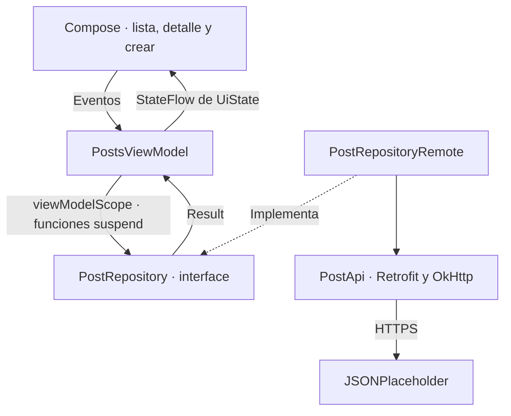

# MuroCampus — Servicio Web

## Descripción del proyecto

**MuroCampus — Servicio Web** es una aplicación Android desarrollada para el Laboratorio 09 del curso de Programación en Móviles (Tecsup). Permite listar publicaciones desde el servicio web JSONPlaceholder, visualizar el detalle de una publicación junto con sus comentarios, filtrar las publicaciones por usuario mediante chips interactivos, y enviar nuevas publicaciones mediante un formulario con peticiones POST simuladas.

## Tecnologías utilizadas

- Lenguaje: **Kotlin 2.1.0**
- UI: **Jetpack Compose** (Material 3, Material You)
- Red y Serialización: **Retrofit 2.11.0**, **OkHttp 4.12.0** (con Logging Interceptor), **kotlinx.serialization**
- Arquitectura: **MVVM + Repository**, Corrutinas y Flows (`StateFlow`, `collectAsStateWithLifecycle`)
- API REST: **JSONPlaceholder** (`https://jsonplaceholder.typicode.com/`)

## Estructura de paquetes

```text
com.tecsup.murocampus/
├── MainActivity.kt
├── model/
│   └── Modelos.kt
├── data/
│   ├── remote/
│   │   ├── PostApi.kt
│   │   └── RetrofitClient.kt
│   └── PostRepository.kt
├── viewmodel/
│   ├── PostsViewModel.kt
│   ├── PostsViewModelFactory.kt
│   └── UiState.kt
└── ui/
    ├── Componentes.kt
    ├── PantallaLista.kt
    ├── PantallaDetalle.kt
    ├── PantallaCrear.kt
    └── theme/
```

## Diagrama MVVM + Repository



## Capturas del emulador

| Captura | Espacio / Estado | Qué aparece |
| --- | --- | --- |
| Lista | [Insertar captura aquí] | Barra MuroCampus, chips de filtro y tarjetas con etiquetas de usuario. |
| Detalle | [Insertar captura aquí] | Publicación completa y comentarios con correos en azul. |
| Filtro | [Insertar captura aquí] | Chip de usuario activo y publicaciones filtradas. |
| Crear | [Insertar captura aquí] | Formulario de creación y mensaje de éxito de publicación. |
| Error de conexión | [Insertar captura aquí] | Mensaje de error de red y botón Reintentar. |

## Para pensar (Respuestas)

1. **¿Qué diferencia hay entre GET y POST? ¿Por qué crear lleva `@Body` y porUsuario lleva `@Query`?**
   - GET solicita recursos sin alterar el estado del servidor, mientras que POST envía datos nuevos para ser creados. `@Body` serializa el objeto en el cuerpo HTTP de la solicitud POST, mientras que `@Query` añade parámetros en la URL (`?userId=2`) para filtrar las peticiones GET.

2. **¿Por qué la ruta es "posts" y no "/posts"?**
   - En Retrofit, las rutas que inician con `/` reemplazan completamente la URL base. Las rutas relativas sin `/` (como `"posts"`) se concatenan correctamente al final de la URL base configurada.

3. **¿Por qué el Repository devuelve Result en vez de dejar que la excepción llegue al ViewModel?**
   - Para encapsular el éxito y el fallo de la operación de red en un contenedor seguro (`Result<T>`), permitiendo que el ViewModel maneje los errores de forma declarativa sin propagar excepciones no controladas a la UI.

4. **¿Qué pasa si olvidas el permiso INTERNET? ¿Y si olvidas ignoreUnknownKeys y el servidor agrega un campo nuevo?**
   - Sin el permiso `INTERNET`, la app genera un crash de seguridad. Sin `ignoreUnknownKeys = true`, la presencia de un campo desconocido devuelto por el servidor provoca un error de serialización (`SerializationException`).

5. **¿Por qué la pantalla de lista usa un when sobre UiState y no un if con tres variables?**
   - Porque `UiState` es una interfaz sellada (`sealed interface`) con estados exclusivos (`Cargando`, `Exito`, `Error`), lo que permite un manejo exhaustivo, limpio y seguro de todos los casos posibles en la UI mediante `when`.

6. **JSONPlaceholder no guarda los POST. ¿Cómo cambiaría tu app si usaras un servicio real?**
   - Con un servicio real y persistente, la app debería actualizar el estado local (añadiendo el post recién creado a la lista) tras recibir la respuesta exitosa del servidor, o sincronizarse mediante almacenamiento local (Room) para reflejar los cambios instantáneamente.

## Verificaciones realizadas

- Compilación exitosa con Gradle (`./gradlew assembleDebug`).
- Carga correcta de 100 publicaciones y 5 comentarios por publicación.
- Filtrado por usuario y restablecimiento mediante "Todos".
- Envío de publicaciones con respuesta HTTP 201 e ID 101.
- Manejo robusto de errores de red con reintento y rotación de pantalla preservando el estado.

## Registro de asistencia de IA

Desarrollo guiado mediante asistente de IA conforme a los lineamientos del Laboratorio 09 de Programación en Móviles (Tecsup).
