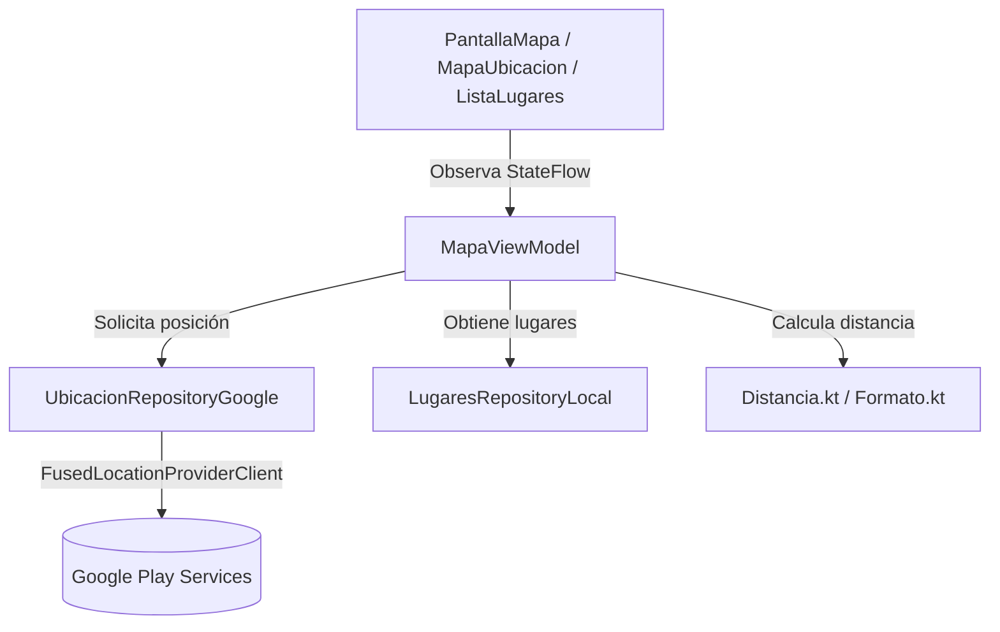
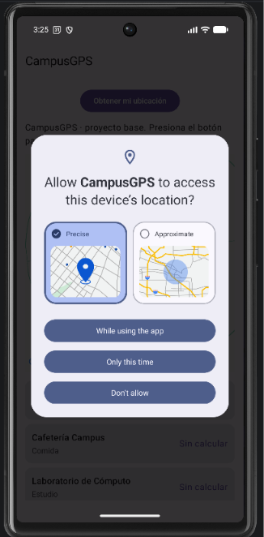
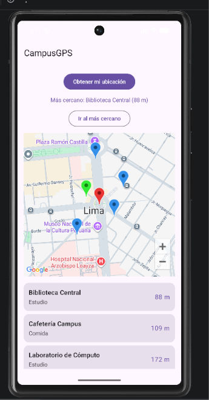
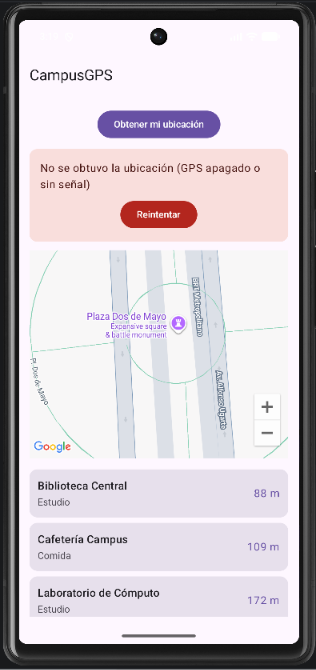

# CampusGPS — Laboratorio 13: Localización Geográfica

## 1. Descripción del proyecto
Aplicación Android desarrollada en Kotlin y Jetpack Compose que implementa geolocalización en tiempo real utilizando Google Play Services Location y Google Maps Compose. Permite visualizar la ubicación actual del usuario en un mapa interactivo de Google Maps, consultar los puntos de interés de un campus universitario (Biblioteca, Cafetería, Laboratorio, Auditorio y Estacionamiento), calcular y ordenar dinámicamente las distancias en metros y kilómetros, resaltar el lugar más cercano e interactuar con la lista de tarjetas y marcadores geográficos.

## 2. Tecnologías
- **Kotlin** & Coroutines.
- **Jetpack Compose** & Material 3.
- **Google Maps Compose** (`com.google.maps.android:maps-compose`).
- **Google Play Services Location** (`com.google.android.gms:play-services-location`).
- **Arquitectura MVVM + Repository**.

## 3. Estructura de paquetes
```text
com.tecsup.campusgps
├── data/
│   ├── LugaresRepository.kt
│   ├── LugaresRepositoryLocal.kt
│   ├── UbicacionRepository.kt
│   └── UbicacionRepositoryGoogle.kt
├── model/
│   └── Modelos.kt
├── ui/
│   ├── ListaLugares.kt
│   ├── MapaUbicacion.kt
│   ├── MensajeError.kt
│   └── PantallaMapa.kt
├── util/
│   ├── Distancia.kt
│   └── Formato.kt
└── viewmodel/
    ├── CampusViewModelFactory.kt
    └── MapaViewModel.kt
```

## 4. Diagrama de arquitectura MVVM + Repository


## 5. Instrucciones de ejecución
1. Clonar o abrir el proyecto en Android Studio (`CampusGPS`).
2. Configurar el archivo `local.properties` en la raíz del proyecto agregando la clave de API de Google Maps:
   ```properties
   MAPS_API_KEY=tu_clave_de_api_aqui
   ```
3. Sincronizar Gradle y ejecutar la aplicación en un emulador o dispositivo físico con Google Play Services.

## 6. Configuración de Google Maps (Seguridad de API Key)
La clave de API de Google Maps (`MAPS_API_KEY`) se almacena exclusivamente en `local.properties`, el cual se encuentra listado en `.gitignore` para evitar su exposición en repositorios públicos. Gradle lee la clave desde `local.properties` y la inyecta mediante `manifestPlaceholders` en el `AndroidManifest.xml` (`com.google.android.geo.API_KEY`).

## 7. Descripción de las funcionalidades (Fase 1)
1. **Gestión de Permisos**: Solicitud dinámica de `ACCESS_FINE_LOCATION` y `ACCESS_COARSE_LOCATION` en tiempo de ejecución.
2. **Mapa Interactivo**: Visualización mediante Google Maps Compose con cámara inicial en Lima y animación al obtener la ubicación actual (marcador rojo).
3. **Marcadores del Campus**: Representación de 5 puntos de interés con marcadores azules (`HUE_AZURE`).
4. **Cálculo de Distancias**: Cálculo en metros utilizando `Location.distanceBetween()` y formateo inteligente (metros o kilómetros).
5. **Lista y Selección**: `LazyColumn` interactiva con ordenamiento por proximidad, resaltado visual de tarjetas y centrado de cámara al seleccionar un lugar.
6. **Lugar más Cercano**: Identificación automática del lugar más próximo (marcador verde `HUE_GREEN`), botón de acceso directo («Ir al más cercano») y texto resumen.
7. **Manejo Robusto de Errores**: Tratamiento de permisos denegados (con botón para abrir ajustes del sistema), GPS apagado (con botón de reintento) y ausencia de Google Play Services.

---

## 8. Evidencias (Espacios para capturas reales)

- **Solicitud de permiso**:
  > 

- **Mapa con ubicación actual**:
  > 

- **Cinco marcadores**:
  > 

- **Lista ordenada**:
  > 

- **Pantalla de error**:
  > 

---

## 9. Preguntas «Para pensar»

1. **¿Por qué FusedLocationProviderClient está dentro del Repository y no en el ViewModel?**
   - Porque el acceso a servicios del sistema Android (`FusedLocationProviderClient`, `Context`, hardware de ubicación) pertenece a la capa de datos (Repository), manteniendo el ViewModel libre de dependencias de Android (`Context`), facilitando las pruebas unitarias y respetando la arquitectura MVVM.

2. **¿Qué diferencia hay entre el permiso de ubicación y la clave de API de Maps? ¿Qué pasa si falta cada uno?**
   - El permiso de ubicación es un permiso de Android otorgado por el usuario en tiempo de ejecución para acceder a los sensores GPS. Si falta, la app no puede obtener la posición actual (`SecurityException`). La clave de API de Maps es la credencial de Google Cloud para renderizar los mapas de Google Maps. Si falta o es inválida, el mapa no carga o muestra error de autenticación.

3. **¿Por qué la clave va en local.properties y no en el código? ¿Qué harías si se subiera a GitHub por error?**
   - Va en `local.properties` porque es un archivo local ignorado por Git, evitando exponer secretos en repositorios públicos. Si se subiera por error, se debe revocar inmediatamente la clave en Google Cloud Console, generar una nueva y purgar el historial de Git.

4. **¿Dónde calculas la distancia y por qué no en el Composable?**
   - La distancia se calcula en la capa de utilidades/dominio (`Distancia.kt`) invocada desde el ViewModel. No se calcula en el Composable para mantener la UI pura, evitar re-computaciones en cada recomposición y mantener separadas las responsabilidades (MVVM).

5. **¿Qué pasa con tu app si el usuario niega el permiso dos veces? ¿Cómo lo manejas?**
   - Si el usuario niega el permiso repetidamente, el sistema no muestra el diálogo automático. La app lo detecta (`TipoError.SIN_PERMISO`), muestra un mensaje explicativo y ofrece un botón «Abrir ajustes» para que el usuario habilite el permiso manualmente en la configuración del sistema.
